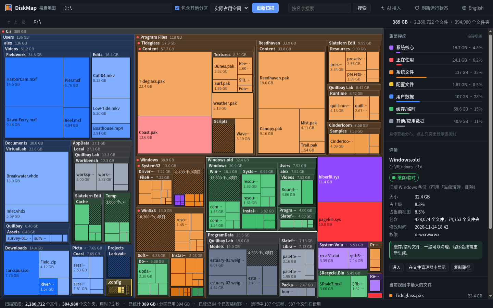
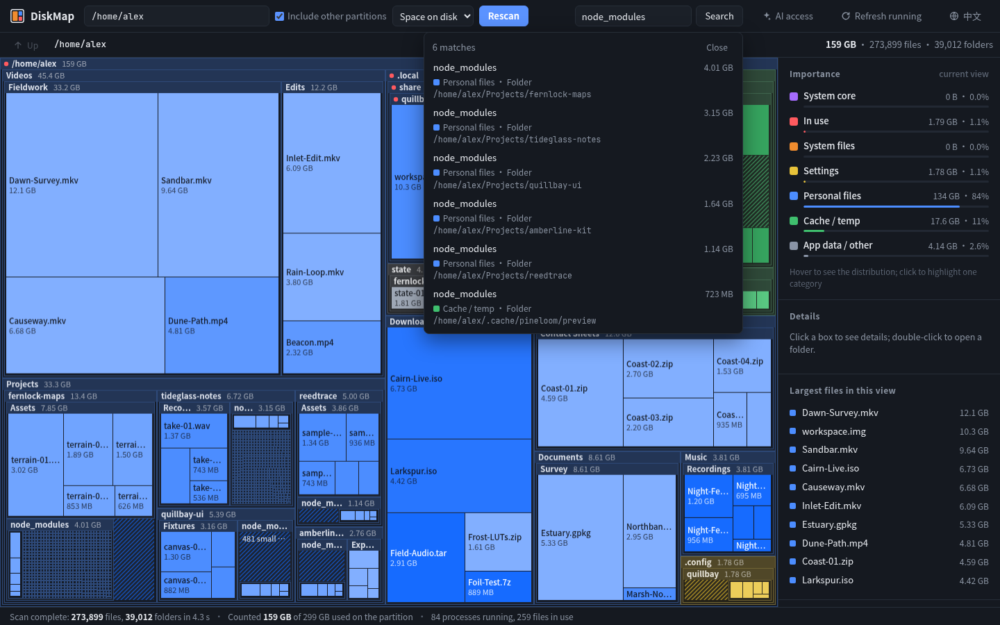
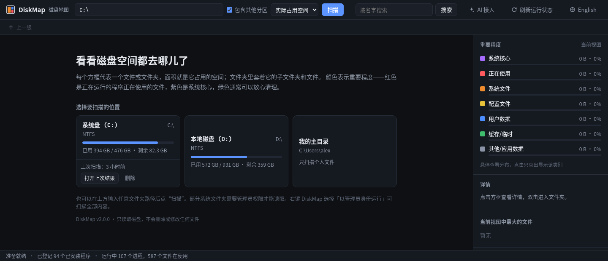

# DiskMap 2.0 磁盘地图

[](https://m8ven.ai/mcp/zi7tian-diskmap-skegpy?s=readme)

用“方框套方框”的方式查看磁盘空间都去哪儿了。每个方框代表一个文件或文件夹，面积与它占用的空间成正比。
颜色表示**重要程度**，界面详情和 MCP 服务会给出分类原因及清理建议。

本版基于 **Rust + Tauri 2**，支持 **Windows 10/11（x64）、macOS 11+（Apple 芯片和 Intel）、Linux（x64）**，
界面有中文和英文。

*DiskMap visualizes disk usage as nested boxes colored by importance. It provides a Chinese/English
desktop interface, command-line reports, and an MCP server for AI assistants. Scanning is read-only.*



本页截图中的数据均为虚构示例。

| 颜色 | 类别 | Windows | macOS | Linux |
|---|---|---|---|---|
| 紫 | 系统核心 | 驱动、注册表、启动文件、休眠文件、MFT 可见的 NTFS 元文件 | `/System`、虚拟内存 | `/boot`、内核模块、固件、交换文件 |
| 红 | 正在使用 | 运行中的可执行文件、DLL、映像和数据映射文件，以及页面文件 | 可执行文件、打开的文件 | 可执行文件、加载和打开的文件、启用的交换文件 |
| 橙 | 系统文件 | `C:\Windows`、Program Files | `/Applications`、`/Library`、Homebrew | pacman、dpkg、rpm 安装的文件 |
| 黄 | 配置文件 | `.ssh`、`NTUSER.DAT` | `~/Library/Preferences` | `/etc`、`~/.config`、点文件 |
| 蓝 | 用户数据 | 文档、下载、OneDrive | 文稿、iCloud 云盘 | 主目录中的个人文件 |
| 绿 | 缓存/临时 | Temp、回收站、更新缓存、`Windows.old` | `~/Library/Caches`、废纸篓、Xcode DerivedData | `~/.cache`、`/var/cache`、日志、回收站 |
| 灰 | 其他/应用数据 | AppData、ProgramData | `~/Library/Application Support` | `/var/lib`、`~/.local/state` |

在顶栏按名字搜索，可以查找整个扫描结果中的文件和文件夹，点结果跳到对应位置。



## 下载安装

下载 **2.0** 版本，文件名里的 `<v>` 是不带 `v` 的版本号，如 `2.0.0`。[Releases](https://github.com/zi7tian/diskmap/releases)

### 桌面版

| 系统 | 文件 | 用法 |
|---|---|---|
| Windows | `DiskMap-<v>-windows-x64-setup.exe` | NSIS，给当前用户安装，无需管理员权限 |
| Windows | `DiskMap-<v>-windows-x64.msi` | MSI，需要管理员权限 |
| Windows | `DiskMap-<v>-windows-x64-portable.zip` | 解压，将两个 exe 留在同一目录，双击 `DiskMap.exe` |
| macOS（Apple 芯片） | `DiskMap-<v>-macos-arm64.dmg` | 打开后将 DiskMap 拖进“应用程序” |
| macOS（Intel） | `DiskMap-<v>-macos-x64.dmg` | 打开后将 DiskMap 拖进“应用程序” |
| Linux | `DiskMap-<v>-linux-x64.deb` | 用 `sudo apt install ./DiskMap-<v>-linux-x64.deb` 安装 |
| Linux | `DiskMap-<v>-linux-x64.AppImage` | 在文件属性中允许执行后打开，需要 FUSE 2 |
| Linux | `DiskMap-<v>-linux-x64.tar.gz` | 解压后运行 `./DiskMap`，可用附带的 `./install-desktop.sh` 加入应用菜单 |

桌面版随包附带 `diskmap-cli`。Linux 发行包要求 glibc 2.35 或更新版本。

- **Windows** 需要 WebView2 Runtime。首次运行若提示“Windows 已保护你的电脑”，可点“更多信息 → 仍要运行”。
- **macOS** 的应用未经 Apple 公证。若提示“无法验证开发者”，在“系统设置 → 隐私与安全性”中点“仍要打开”。扫描文稿、下载等目录时按需要授权。
- **Linux AppImage** 缺少 FUSE 2 时，可运行 `./DiskMap-<v>-linux-x64.AppImage --appimage-extract-and-run`。[AppImage 解包运行说明](https://docs.appimage.org/user-guide/troubleshooting/fuse.html#extract-and-run-type-2-appimages)
- **Linux tar.gz** 需要 WebKitGTK 4.1。常见发行版的运行库和开发包如下。

| 发行版 | 运行库 | 开发包 |
|---|---|---|
| Debian / Ubuntu | `libwebkit2gtk-4.1-0` | `libwebkit2gtk-4.1-dev` |
| Fedora | `webkit2gtk4.1` | `webkit2gtk4.1-devel` |
| Arch Linux | `webkit2gtk-4.1` | `webkit2gtk-4.1` |

### 只下载命令行

下载 `diskmap-cli-<v>-<平台>.zip`（Windows）或 `diskmap-cli-<v>-<平台>.tar.gz`（macOS、Linux），解压后运行
`diskmap-cli`。平台名为 `windows-x64`、`macos-arm64`、`macos-x64`、`linux-x64`。
CLI 可生成报告、启动浏览器界面和提供 MCP 服务。发布附件含 `SHA256SUMS.txt`。

启动桌面版后，从欢迎页选择磁盘或主目录开始扫描。



## MCP 服务

DiskMap 内置标准输入输出 MCP 服务。打开窗口右上角的 **“AI 接入”** 可查看当前程序的配置。
Claude Code 用户可将下列命令中的路径替换成实际的绝对路径，再执行注册。[Claude Code MCP 文档](https://code.claude.com/docs/en/mcp)

```bash
claude mcp add --scope user diskmap -- /absolute/path/DiskMap mcp
```

Claude Desktop、Cursor 等使用 `mcpServers` 的客户端可填入以下配置。[各客户端的接入说明](skills/diskmap/references/setup.md)

```json
{
  "mcpServers": {
    "diskmap": {
      "command": "/absolute/path/DiskMap",
      "args": ["mcp"]
    }
  }
}
```

| 安装方式 | `command` 使用的程序路径 |
|---|---|
| Windows NSIS | `%LOCALAPPDATA%\Programs\DiskMap\DiskMap.exe` |
| Windows MSI | `C:\Program Files\DiskMap\DiskMap.exe` |
| Windows 免安装版 | 解压目录内 `DiskMap.exe` 的绝对路径 |
| macOS | `/Applications/DiskMap.app/Contents/MacOS/DiskMap` |
| Linux deb | `/usr/bin/DiskMap` |
| Linux tar.gz | 解压目录内 `DiskMap` 的绝对路径 |
| Linux AppImage | 可执行的 `.AppImage` 文件的绝对路径 |
| 源码构建 | `target/release/DiskMap` 的绝对路径，Windows 加 `.exe` |

在 JSON 中填写展开后的绝对路径，并将 Windows 路径中的反斜杠写成 `\\`。`diskmap-cli mcp` 提供相同的接口，
只下载 CLI 时填写 CLI 的绝对路径。AppImage 用解包模式运行时，设置 `"args": ["--appimage-extract-and-run", "mcp"]`。

有正在运行的窗口时，MCP 可以读取已有结果，AI 发起的扫描也会显示在窗口中。没有可用窗口时，MCP 会在后台按需扫描。
可给 `mcp` 加 `--no-attach` 使用独立后台模式，或加 `--lang en` 指定英文输出。

| 工具 | 作用 |
|---|---|
| `diskmap_status` | 查看扫描范围、进度和窗口连接情况 |
| `diskmap_scan` | 扫描文件夹或整盘，可复用相容的结果 |
| `diskmap_summary` | 查看类别分布、大项目和可清理空间 |
| `diskmap_list` | 列出直接子项 |
| `diskmap_explain` | 查看分类原因、软件包、进程和清理建议 |
| `diskmap_cleanup` | 列出清理候选及可回收空间 |
| `diskmap_largest_files` | 列出最大的文件，可按类别筛选 |
| `diskmap_user_view` | 查看窗口中的目录和选中项，需要连接窗口 |
| `diskmap_show` | 在窗口中跳转并高亮项目，需要连接窗口 |

**技能包（Agent Skill）**包含分析流程、安全等级、接入方法和清理指南。Claude Code 用户可将 `skills/diskmap/`
复制到 `~/.claude/skills/diskmap/`，需要上传 ZIP 的平台可下载发布附件 `diskmap-skill.zip`。[技能包说明](skills/diskmap/SKILL.md)

## 从源码运行

需要 **Rust 1.90+** 和相应平台的编译工具链。构建桌面版还需 Tauri 2 的系统开发依赖，
Linux 的 WebKitGTK 开发包列在下载安装一节。[Tauri Prerequisites](https://v2.tauri.app/start/prerequisites/)

在仓库根目录构建并启动桌面版，以下命令适用于 Linux 和 macOS。

```bash
cargo build --release -p diskmap-cli -p diskmap-desktop
./target/release/DiskMap
```

Windows 的构建命令相同，生成 `target\release\DiskMap.exe` 和 `target\release\diskmap-cli.exe`。
也可只构建 CLI，并扫描仓库的 `web/` 目录，在浏览器中打开终端输出的链接。

```bash
cargo build --release -p diskmap-cli
./target/release/diskmap-cli serve ./web --no-open
```

开发验证可运行 `cargo fmt --all`、`cargo clippy --workspace --all-targets -- -D warnings` 和 `cargo test --workspace`。
调试服务时可把 `DISKMAP_CACHE_DIR`、`DISKMAP_CONFIG_DIR` 指向临时目录，隔离缓存和设置。

## 其他注意事项

- DiskMap 只读扫描目标，清理由用户自行操作。
- Windows 的 MFT 快速扫描需要以管理员身份运行，并扫描整个本地 NTFS 卷。其他情况使用通用扫描。
- 界面或 MCP 发起的扫描完成后会自动保存结果，可在欢迎页打开。缓存包含扫描到的文件名。
- 点右上角的 **English / 中文** 切换界面语言，程序会记住选择。
- 从 1.x 升级会沿用设置。安装路径变更时需更新 MCP 配置中的程序路径。
- Windows 的“正在使用”检测覆盖可执行文件、DLL、映像和数据映射，尚未覆盖未映射的普通打开文件。
- macOS 2.0 版未在真机上验证。
- Python 1.3 版保留在 `legacy/`，依赖见 [legacy/requirements.txt](legacy/requirements.txt)。
- 命令行用法见 `diskmap-cli --help`，也可加子命令查看对应帮助。

## 许可证

[MIT](LICENSE)。可以自由使用、修改和分发，保留版权声明即可。
